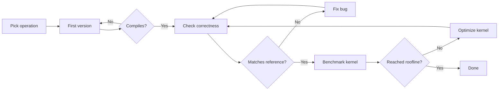

# SimpleCode

Multi-agent pipeline orchestrator for AI coding agents. Chain multiple agents with numbered prompts, human-in-the-loop gates, and context passing between agents.

Supported runtimes: `claude`, `cursor`, `codex`, `opencode`, `pi`.

## Install

```bash
pip install git+https://github.com/CraftsMan-Labs/SimpleCode.git
```

Optional: AST code search via [cocoindex-code](https://github.com/cocoindex-io/cocoindex-code) (`simplecode sync` / `search` / `--code-context`):

```bash
pip install 'simplecode[code]'
```

Pin to a release:

```bash
pip install git+https://github.com/CraftsMan-Labs/SimpleCode.git@v0.1.0
```

## Quick start

```bash
simplecode init feature-dev
echo "Add OAuth2 login to the API" > TASK.md
simplecode run feature-dev          # picks up TASK.md (or ISSUE.md) automatically
# or: simplecode run feature-dev TASK.md
# or: simplecode run feature-dev "Add OAuth2 login to the API"
```

Pipelines: `.simplecode/pipelines/` or `~/.simplecode/pipelines/`. See [docs/simplecode-dir.md](docs/simplecode-dir.md).

## Loading a task

Prompts (`1.md`, `2.md`, ...) are **static templates** that define what each agent does. The specific task you want to accomplish is passed via `-i` (input files):

```bash
simplecode run -f pipeline.yaml -r claude -w /path/to/repo \
  -i TASK.md \
  -i CONSTRAINTS.md \
  -t 86400
```

Input files are injected as context into the **first agent's first prompt**. Each subsequent agent automatically receives the previous agent's output as context instead.

```
TASK.md ──→ planner (1.md, 2.md)
                │
                └─ output.md ──→ executor (1.md)
                                     │
                                     └─ output.md ──→ reviewer (1.md)
```

## Pipeline YAML

```yaml
name: feature-dev
description: Plan, execute, and review

# setup: setup.sh   # optional — runs before agents start

agents:
  - id: planner
    prompts: prompts/planner/
    gate: human
    permissions: read-only
    timeout: 86400
    model: opus

  - id: executor
    prompts: prompts/executor/
    runtime: opencode          # override the default runtime
    permissions: write
    timeout: 86400

  - id: reviewer
    prompts: prompts/reviewer/
    gate: human
    permissions: read-only
```

### Agent fields

| Field | Required | Default | Values |
|-------|----------|---------|--------|
| `id` | yes | — | unique string |
| `prompts` | yes | — | path to dir with `1.md`, `2.md`, ... |
| `gate` | no | none | `human` |
| `permissions` | no | `write` | `read-only`, `write`, `full` |
| `timeout` | no | `300` | seconds |
| `runtime` | no | CLI default | `claude`, `cursor`, `codex`, `opencode`, `pi` |
| `model` | no | CLI default | any model the runtime supports |

## CLI

```bash
simplecode run -f pipeline.yaml [options]
```

| Flag | Default | Description |
|------|---------|-------------|
| `-r, --runtime` | `claude` | Default runtime for all agents |
| `-w, --working-dir` | `.` | Repo the agents work in |
| `-t, --timeout` | `300` | Default timeout per agent (seconds) |
| `-m, --model` | — | Default model |
| `-i, --input` | — | Task/context files injected into the first agent (repeatable) |
| `-o, --output` | `./pipeline-output` | Output directory |
| `--permissions` | `write` | Default permission level |
| `--gate-mode` | `stdin` | `stdin` (interactive), `file` (CI/cloud), or `checkpoint` (save and exit) |
| `--gate-dir` | — | Directory for file-based gate artifacts |
| `--database-url` | SQLite default | Session store for `checkpoint` / `resume` (or `SIMPLECODE_DATABASE_URL`) |

Other commands:

```bash
simplecode init <name> --agents <n>   # scaffold a new pipeline
simplecode list -f pipeline.yaml      # show agents and prompt counts
simplecode resume -s <session-id> --approve
simplecode sessions --status waiting
simplecode serve --pipeline-map '{"triage":"examples/github-issue-triage"}' --repos owner/repo
```

## Gates

Agents with `gate: human` pause the pipeline after running. You then enter a feedback loop in the same CLI session:

- **Type feedback** — sent to the agent, it responds, you review again
- **Type `approve` or `PNS`** — proceeds to the next agent
- **Type `stop` / `reject` / `quit` / `abort`** — stops the pipeline

### File-based gates (CI/cloud)

Use `--gate-mode file --gate-dir ./gates` for non-interactive environments.

The orchestrator writes `{gate-dir}/{agent-id}.gate` with the agent's output. To respond:

- Write feedback to `{agent-id}.feedback` — agent processes it, updates `.gate`
- Write `PNS` to `{agent-id}.feedback` — advances the pipeline
- Create `{agent-id}.rejected` — stops the pipeline

## Python API

```python
from pathlib import Path
from simplecode import Pipeline, PipelineConfig, AgentConfig

config = PipelineConfig(
    name="my-pipeline",
    agents=[
        AgentConfig(id="planner", prompts="prompts/planner/", gate="human", permissions="read-only"),
        AgentConfig(id="executor", prompts="prompts/executor/", permissions="write"),
    ],
)

pipeline = Pipeline(config, pipeline_dir=Path("./my-pipeline"))
result = pipeline.run(
    runtime="claude",
    working_dir="/path/to/repo",
    timeout=86400,
)
```

## How it works

1. Load `pipeline.yaml`, validate config
2. Run `setup.sh` if defined
3. For each agent:
   - Run numbered prompts (`1.md`, `2.md`, ...) sequentially in one CLI session
   - If `gate: human` — enter feedback loop, advance on `PNS`
   - Write `output.md` — automatically passed as context to the next agent

Output goes to `pipeline-output/{session-id}/`:

```
pipeline-output/a1b2c3d4/
├── pipeline.json
├── planner/
│   ├── prompt-1.md
│   ├── 1-output.md
│   ├── prompt-2.md
│   ├── 2-output.md
│   ├── gate-1-input.md
│   ├── gate-1-output.md
│   └── output.md
└── executor/
    └── ...
```

## Development

```bash
git clone https://github.com/CraftsMan-Labs/SimpleCode.git
cd SimpleCode
make dev          # install with dev deps
make check        # lint + typecheck + tests
make fmt          # auto-format
make test-live    # run live tests (needs a runtime on PATH)
```

Requires Python 3.13+.

## Factory chains

Two ready-made example pipelines encode the workshop factory as **separate** chains:

| Chain | Path | Agents |
|-------|------|--------|
| Spec → Tickets | [`examples/spec-to-tickets/`](examples/spec-to-tickets/) | `spec-interviewer` → `ticket-writer` |
| Ticket Delivery | [`examples/ticket-delivery/`](examples/ticket-delivery/) | `explorer` → `builder` → `adversarial` → `qa` |
| Unattended delivery | [`examples/factory-ticket-delivery/`](examples/factory-ticket-delivery/) | `explorer` → `builder` → `adversarial` → `fixer` → `qa` |

```bash
# Align and cut tickets
simplecode run -f examples/spec-to-tickets/pipeline.yaml -r claude -w . -i TASK.md -t 86400

# Deliver one ticket
simplecode run -f examples/ticket-delivery/pipeline.yaml -r claude -w . -i TICKET.md -t 86400
```

Handoff is artifact-based: copy one ticket from the first chain into `TICKET.md`, then run the second. See [Examples](docs/examples.md) for the full pattern.

For continuous delivery, [`simplecode factory`](docs/software-factory.md) polls
allowlisted Plane projects, runs the unattended chain in an isolated worktree,
and opens a draft GitHub PR only after an exact QA pass.

```bash
simplecode factory --config factory.yaml
# Dashboard: http://127.0.0.1:8090

simplecode factory --config factory.yaml --dashboard-port 9090
simplecode factory --config factory.yaml --no-dashboard
```

The read-only dashboard polls durable job and event data every two seconds. It
shows claim, checkout/setup, agent/prompt, verdict, publish, Plane review,
recovery, completion, and failure progress without returning ticket bodies,
prompts, or agent output. The factory creates one Plane progress comment per
job and updates it at milestones and agent boundaries; prompt events remain in
the local event timeline without creating comment noise.

The dashboard binds only to loopback and has no authentication or TLS. Do not
expose it beyond the local host. If its port is unavailable, factory polling
continues with a warning; choose another `--dashboard-port` or use
`--no-dashboard`. See the factory guide for database, stale-event, Plane
comment, and publication troubleshooting.

## Kernel optimization example

[`examples/kernel-optimization/`](examples/kernel-optimization/) implements the
compile, correctness, benchmark, and optimization workflow as one stateful
SimpleCode agent:



```bash
simplecode run \
  -f examples/kernel-optimization/pipeline.yaml \
  -r claude \
  -w ~/projects/myapp \
  -i ~/projects/myapp/KERNEL-TASK.md \
  -t 86400
```

SimpleCode YAML is sequential, so the decision loops run inside the agent's
numbered prompts. See the [example README](examples/kernel-optimization/README.md)
for setup and customization.

## Docs

See the [docs/](docs/) directory for detailed guides:

- [Getting started](docs/getting-started.md)
- [Pipeline YAML reference](docs/pipeline-yaml.md)
- [CLI reference](docs/cli-reference.md)
- [Gates](docs/gates.md)
- [Runtimes](docs/runtimes.md)
- [Workspace isolation](docs/workspace.md)
- [Shared agent stack](docs/agent-stack.md) (9Router + CocoIndex)
- [Python API](docs/python-api.md)
- [Examples](docs/examples.md)
- [GitHub webhooks](docs/github-webhooks.md)
- [Plane software factory](docs/software-factory.md)
- [Output artifacts](docs/output-artifacts.md)

## License

MIT — CraftsmanLabs
