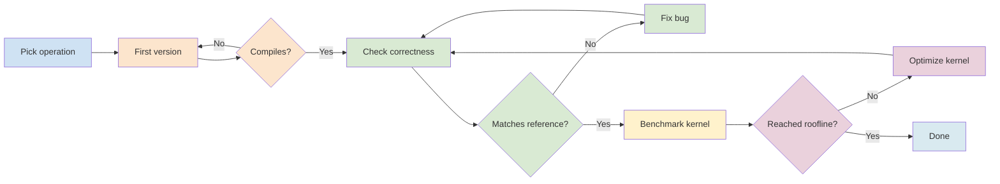

# Kernel Optimization Pipeline

This pipeline takes one compute operation from a simple first implementation
through compilation, reference validation, benchmarking, and iterative
optimization.

## Flow



SimpleCode executes agents and prompts sequentially, so the conditional loops in
the diagram are implemented by the `kernel-engineer` agent inside its numbered
prompts. Keeping all four prompts in one agent also preserves the runtime session
and its context between iterations.

## Prompts

1. Pick the requested operation and implement a clear first version.
2. Compile and fix build failures until the build passes.
3. Compare with the reference and fix correctness bugs until all checks pass.
4. Benchmark, optimize, revalidate, and repeat until the stated target is reached.

## Usage

Copy and complete the task template, then run the pipeline against the target
repository:

```bash
cp examples/kernel-optimization/TASK.md ~/projects/myapp/KERNEL-TASK.md

simplecode run \
  -f examples/kernel-optimization/pipeline.yaml \
  -r claude \
  -w ~/projects/myapp \
  -i ~/projects/myapp/KERNEL-TASK.md \
  -t 86400
```

The final human gate lets you review the measurements and correctness evidence.
Type `PNS` to approve the result, provide feedback to continue the same agent
session, or type `stop` to reject it.
